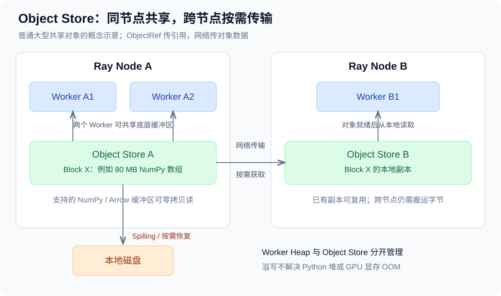
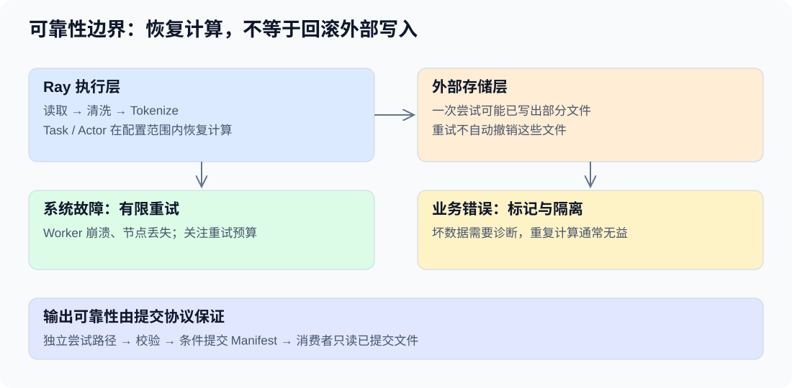
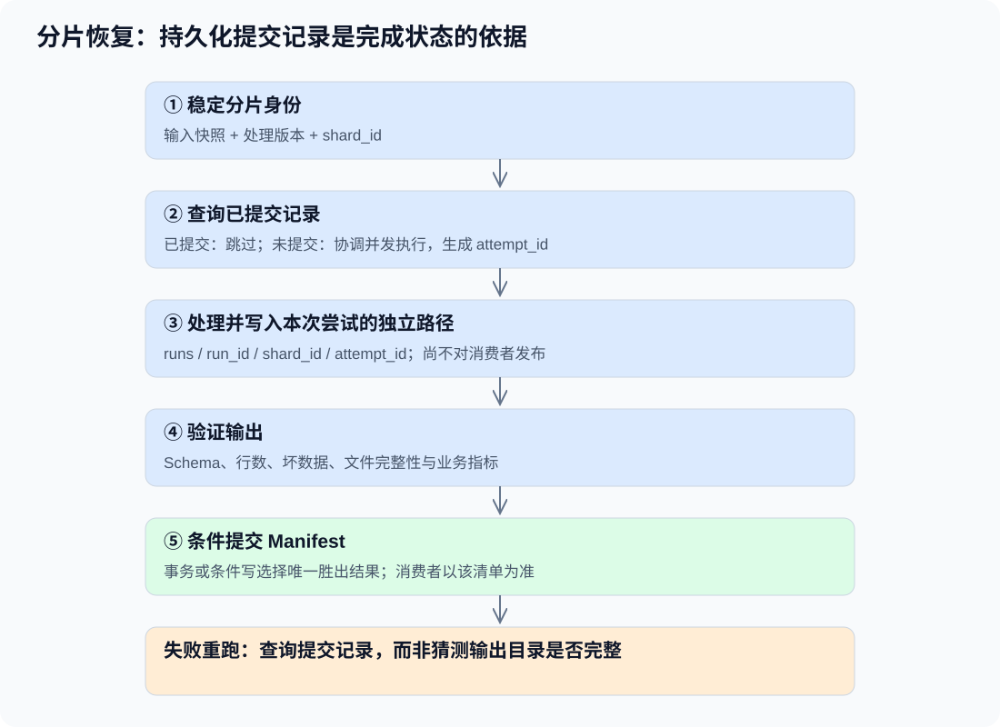
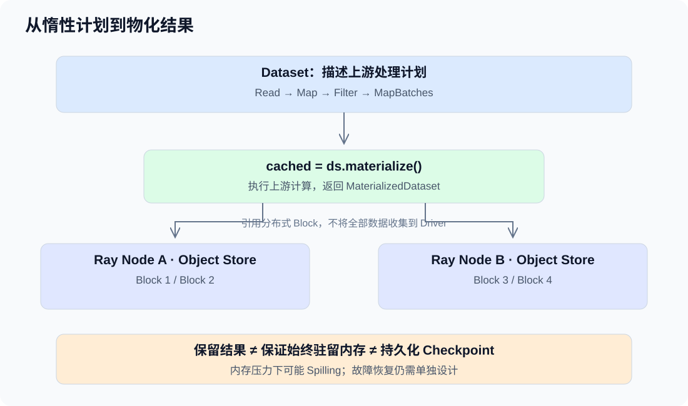
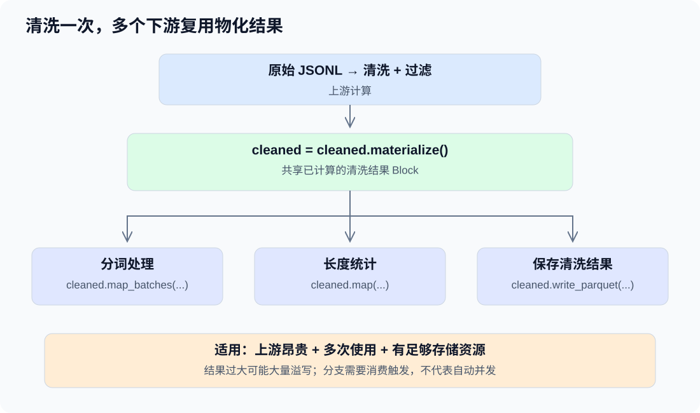
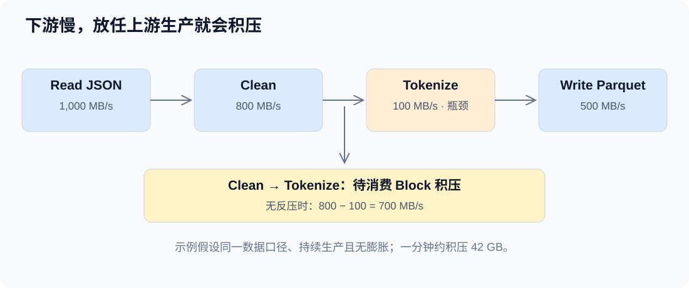
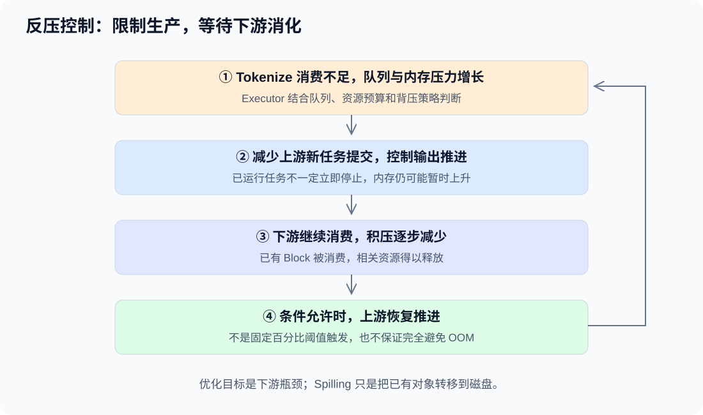
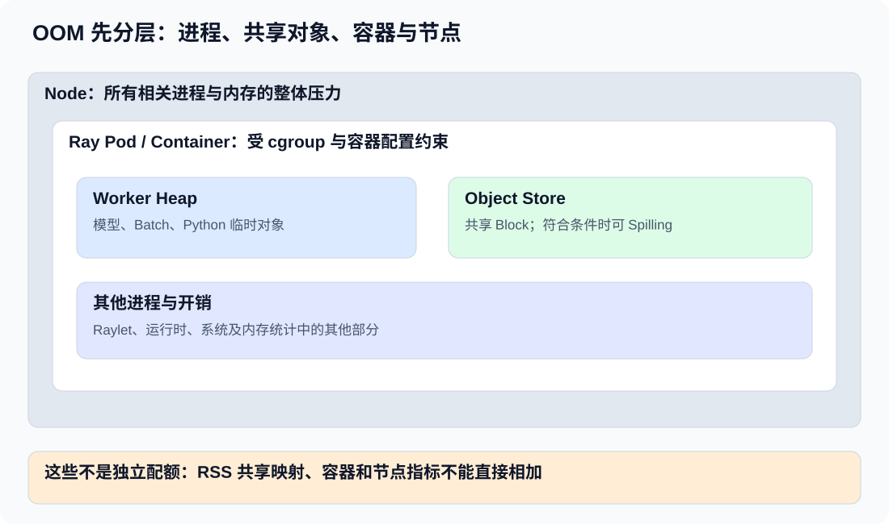
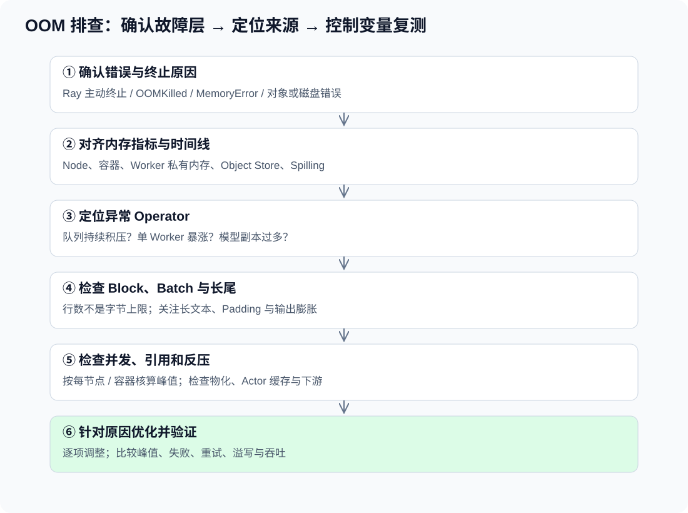

# Ray Data

## 第一题：解释 Ray Data 核心概念

### 一、Ray Data 核心概念总览

| 层次 | 核心概念 | 作用 |
| --- | --- | --- |
| 数据模型 | Dataset | 用户操作的分布式数据集 |
| 数据模型 | Block | 实际存储和处理的数据分块 |
| 数据模型 | Block Metadata | 记录行数、大小、Schema 等信息 |
| 执行模型 | Logical Plan | 描述要执行哪些操作 |
| 执行模型 | Physical Plan | 将逻辑操作转换成物理算子后的执行计划 |
| 执行模型 | Operator | 组织具体的数据处理过程 |
| 执行模型 | Streaming Executor | 流水线式调度物理算子 |
| 算子模型 | map / filter | 逐行处理 |
| 算子模型 | map_batches | 批量处理 |
| 算子模型 | groupby / sort / repartition | 聚合、排序与数据重分布 |
| 调度模型 | Task | 一次具体的计算任务 |
| 调度模型 | Actor | 可复用的有状态计算进程 |
| 调度模型 | Worker | 执行 Task 或 Actor 的进程 |
| 内存模型 | Object Store | 分布在各节点上的对象存储 |
| 内存模型 | ObjectRef | 对象引用 |
| 内存模型 | Spilling | 对象存储内存不足时将对象溢写到磁盘 |
| 内存模型 | Backpressure | 控制上下游处理速度 |
| 容错模型 | Lineage | 记录数据的计算依赖关系 |
| 容错模型 | Retry | 失败后重试任务或计算 |

其中最重要的 8 个概念是：

**Dataset、Block、Task、Operator、Streaming Executor、Object Store、Actor、Backpressure。**

理解它们，基本就能建立 Ray Data 的整体架构认知。

### 二、通过一个例子理解整个执行过程

假设使用 Ray Data 处理 1TB JSONL 数据：

```python
import ray

# clean_text、is_valid、tokenize_batch 为需要自行实现的处理函数。
ds = ray.data.read_json("s3://bucket/input/")
ds = ds.map(clean_text)
ds = ds.filter(is_valid)
ds = ds.map_batches(
    tokenize_batch,
    batch_size=1000,
    concurrency=4,
)
ds.write_parquet("s3://bucket/output/")
```

简化后的执行架构：


概念示意：各算子可在不同节点并发执行；实际物理算子可能经过融合优化。

这里需要特别区分：

- **Block 是数据单位**，一个 Block 包含多行数据。
- **Task 是执行单位**，一次 Task 可以处理一个或多个 Block，也可能产生多个 Block。
- **Operator 是计算阶段**，负责组织具体计算；执行计算的物理算子可以管理一组 Task 或 Actor。
- **Executor 是调度协调者**，决定什么时候给 Operator 分配输入和启动计算；具体任务的节点放置由 Ray 运行时负责。

Ray Data 采用流水线执行，不需要等待所有数据完成 Read 才启动后面的 Map。

### 三、容易混淆的几个概念

| 概念 | 容易产生的误解 | 正确认识 |
| --- | --- | --- |
| Dataset | 所有数据都在 Driver 内存里 | Driver 主要持有数据集描述和引用 |
| Block | 一个 Block 对应一个 Task | 不保证一一对应 |
| Batch | 一个 Batch 就是一个 Block | Batch 是用户函数处理的数据批次 |
| Task | 一个 Task 就是一个 Worker | Worker 进程可以先后执行多个 Task |
| Actor | 和 Task 没区别 | Actor 能跨多次调用保留状态 |
| ObjectRef | 就是实际的数据 | 它是定位远程对象的引用 |
| Streaming | 等同 Flink 无界流处理 | 主要是有界数据的流水线执行 |
| Spilling | 内存不足就一定不会 OOM | Object Store 可以溢写，但 Worker 堆内存仍可能 OOM |

。

## 第二题：map() 和 map_batches() 有什么区别？

Ray Data 中批处理接口的名称是 `map_batches()`，不是 `batch_map`。最核心的区别是用户函数的调用粒度：

- `map()`：每次处理一行数据。
- `map_batches()`：每次处理一批数据，可以利用 NumPy、PyArrow、Pandas 等进行批量计算。

**`map_batches()` 不一定比 `map()` 快。** 如果内部仍然逐行循环，性能优势可能很小。批量接口能否减少底层操作次数、是否利用向量化，以及数据格式转换开销，都会影响实际性能。

### 一、核心区别

| 对比 | map() | map_batches() |
| --- | --- | --- |
| 处理粒度 | 一行 | 一批 |
| 用户函数输入 | 表示一行的 dict | NumPy 字典、Pandas DataFrame、PyArrow Table 等 |
| 每次函数调用 | 1 行 | 指定 batch_size 时，通常为该行数；尾批次可能较小 |
| 数据处理方式 | 逐行 | 可批量计算，也可在函数内逐行处理 |
| Python 用户函数调用次数 | 通常每行一次 | 通常每批一次 |
| 向量化计算 | 不方便 | 非常适合 |
| 模型批量推理 | 难以直接合并多行输入 | 非常适合 |
| 典型场景 | 字段清洗、简单转换 | Tokenize、特征计算、模型推理 |

`batch_size` 是输入批次大小，不限制函数输出行数；`map_batches()` 可以改变行数。未指定 `batch_size` 时，也不要假设每次调用具有固定行数。

### 二、完整例子

假设有 10,000 条记录，每条包含 `user_id` 和 `amount`，需要计算 `score = amount * 2`。

#### 1. 使用 map()

```python
import ray

ray.init()

ds = ray.data.from_items([
    {"user_id": i, "amount": i}
    for i in range(10000)
])

def process_row(row):
    return {**row, "score": row["amount"] * 2}

result = ds.map(process_row)
print(result.take(3))
```

输出：

```python
[
    {"user_id": 0, "amount": 0, "score": 0},
    {"user_id": 1, "amount": 1, "score": 2},
    {"user_id": 2, "amount": 2, "score": 4},
]
```

如果完整消费全部 10,000 行，在没有重试或重复执行的情况下，`process_row()` 会调用 10,000 次。这里的 `take(3)` 只请求前三行，不保证会处理整个数据集；底层按块执行，也可能处理多于三行。

#### 2. 使用 map_batches()

以下代码可作为另一个独立脚本运行：

```python
import ray

ray.init()

ds = ray.data.from_items([
    {"user_id": i, "amount": i}
    for i in range(10000)
])

def process_batch(batch):
    return {**batch, "score": batch["amount"] * 2}

result = ds.map_batches(
    process_batch,
    batch_size=1000,
    batch_format="numpy",
)
print(result.take(3))
```

输出相同。这里 NumPy 字典中的每个值是一列数组，`batch["amount"] * 2` 会对整列执行向量化计算。返回新字典和新计算结果，也避免原地修改可能只读的输入数组。

完整消费时，如果恰好组成 10 个完整批次，用户函数只需调用 10 次。实际调用次数还取决于数据分块、任务输入组合和尾批次，不能仅用总行数除以 `batch_size` 确定。

### 三、内部执行方式有什么区别？

假设一个 Block 正好包含 1,000 行，且 `batch_size=1000`，可以这样理解用户函数调用过程：

```text
map()
  Block：1000 行
    process_row(第 1 行)
    process_row(第 2 行)
    ...
    process_row(第 1000 行)
  用户函数共调用 1000 次

map_batches()
  Block：1000 行
    process_batch(包含 1000 行的批次)
  此例中用户函数调用 1 次，内部进行 NumPy 批量计算
```

**`map()` 并不是每行启动一个 Ray Task。** Ray 可能使用一个 Task 处理一个 Block，在 Task 内调用 `process_row()` 1,000 次；`map_batches()` 也可能使用一个 Task，只是在 Task 内调用一次批处理函数。

因此，两者的主要区别是用户函数的调用粒度，不能直接据此推导 Ray Task 的数量。实际任务划分还受 Block 组合、算子融合和执行策略影响。

### 四、如果 map_batches() 内部仍然逐行循环呢？

```python
import numpy as np

def process_batch_loop(batch):
    scores = []
    for amount in batch["amount"]:
        scores.append(amount * 2)
    return {**batch, "score": np.array(scores)}
```

虽然使用批处理接口，这个函数仍然执行大量 Python 层循环。对比向量化版本：

```python
def process_batch_vectorized(batch):
    return {**batch, "score": batch["amount"] * 2}
```

第二种把数组运算交给 NumPy 底层实现，通常更快。但实际收益应通过具有代表性的数据和完整消费过程测量，不能只比较调用次数。

### 五、函数调用次数估算

假设各 Block 的行数尽量均匀，且每个 Block 单独切成 Batch，Batch 不跨 Block 边界：

| 参数 | 数值 |
| --- | --- |
| 总行数 | 10,000 |
| batch_size | 1,000 |
| Block 数量 | 8 |
| 每个 Block 行数 | 1,250 |
| map() 用户函数调用次数 | 10,000 |
| map_batches() 用户函数调用次数估算 | 8 × 向上取整(1250 / 1000) = 16 |
| 忽略 Block 边界时的最少批次数 | 向上取整(10000 / 1000) = 10 |

这只是给定假设下的估算，不是 Ray Data 的固定调度规则。实际执行可能组合多个 Block，任务边界也会影响批次构造；失败重试和重复消费还可能增加调用次数。**调用次数不等于运行时间。**

### 六、什么时候应该选择哪个？

选择 `map()`：简单字段转换、规则清洗和逐行处理，尤其是函数无法向量化时。只需要保留或丢弃记录的逐行判断，通常使用 `filter()`。

选择 `map_batches()`：批量 Tokenize、NumPy/Pandas 向量化计算、GPU 推理和批量数据库查询。需要复用模型或 Tokenizer 等昂贵初始化资源时，可以传入可调用类，使用 Actor 保留状态；状态复用不是仅靠增大 Batch 实现的。

结合第一题的 1TB JSONL → 清洗 → Tokenize → Parquet 流水线：

```python
# clean_text、is_valid 和 TokenizerWorker 需要自行定义。
# TokenizerWorker 是实现 __call__ 的类，可在 __init__ 中加载 Tokenizer。
ds = ray.data.read_json("s3://bucket/input/")

# 简单清洗：逐行处理。
ds = ds.map(clean_text)

# 过滤：逐行判断。
ds = ds.filter(is_valid)

# Tokenizer：Actor 复用初始化状态，并批量处理输入。
ds = ds.map_batches(
    TokenizerWorker,
    batch_size=1000,
    concurrency=4,
)

ds.write_parquet("s3://bucket/output/")
```

`TokenizerWorker.__call__` 的输入格式需要与 `batch_format` 匹配，使用具体库时应显式选择合适的格式。

值得记住：`map_batches()` 不只是减少 Python 函数调用次数。对于 Tokenizer 或模型推理，它还可能把多个输入合并成一次底层批量运算，这通常才是显著提升吞吐量的关键。

## 第三题：Ray Data 的数据流水线（Pipeline）如何执行？

Ray Data 把大规模数据组织成多个 **Block**，通过 **Operator** 定义处理阶段，由 **Streaming Executor** 协调，再交给 Ray 的 **Task / Actor** 分布式执行。

核心机制是：**惰性构建计划，消费触发计算，数据块在各阶段之间流水线流动。** 这里的 Pipeline 指处理流水线，不特指旧版的 `DatasetPipeline` API。

### 一、从代码到执行计划

```python
import ray

# clean_text、is_valid 和 TokenizeBatch 需要自行实现。
# TokenizeBatch 是可调用类，其输入应与 batch_format 匹配。
ds = ray.data.read_json("s3://bucket/raw/*.jsonl")
ds = ds.map(clean_text)
ds = ds.filter(is_valid)
ds = ds.map_batches(
    TokenizeBatch,
    batch_size=1000,
    batch_format="numpy",
    concurrency=4,
)
ds.write_parquet("s3://bucket/output/")
```

整个流水线的逻辑如下：


图中展示的是逻辑处理顺序，并不要求全部 Block 完成一个阶段后才能进入下一阶段。

执行过程可以概括为：

1. **构建逻辑计划**：描述 Read → Map → Filter → MapBatches → Write 等操作。转换通常不会立即处理完整数据集，但数据源和元数据查询可能提前产生工作。
2. **触发执行**：`write_parquet()` 等消费或输出操作启动所需计算。`take()`、迭代 `iter_batches()`、`materialize()` 等也会触发计算；部分查询可能利用元数据完成。
3. **生成并优化物理计划**：把逻辑操作映射为物理算子，按规则进行融合等优化。
4. **调度执行**：Executor 为可执行算子提供输入，算子提交 Task 或 Actor 调用，Ray 运行时安排实际执行位置。
5. **传递结果**：上游产生的 Block 引用交给下游，最终写入目标存储。

### 二、流式执行：不同数据块同时处于不同阶段

不需要等全部数据读取完才开始清洗，也不需要等全部清洗完才开始分词。同一时刻可能出现：

| 数据块 | 当前进度 |
| --- | --- |
| Block 1 | 正在 Tokenize |
| Block 2 | 正在 Filter |
| Block 3 | 正在读取或清洗 |

这是逻辑示意，实际 Map、Filter 等操作可能融合在同一任务内。排序、全局聚合等需要跨分片协调的操作也可能形成阶段性等待。

Streaming Executor 持续收集任务输出、更新算子队列，并结合资源预算和背压决定哪些算子可以继续接收输入。**Streaming 在这里主要指有界数据的流水线执行，不代表 Flink 式无界事件流及其 Watermark、窗口和状态 Checkpoint 语义。**

### 三、Operator、Task、Worker 的分工

| 概念 | 职责 |
| --- | --- |
| Physical Operator | 执行控制单元，组织输入、输出、任务及执行状态 |
| Task / Actor | 实际执行用户函数；Actor 可跨调用保留初始化状态 |
| Worker | 运行 Task 或 Actor 的进程 |
| Block | 被处理和传递的数据分片 |
| Streaming Executor | 协调物理算子的执行进度、资源使用与背压 |

物理算子通常不是独立的 Worker 进程。一个计算算子可以管理多个 Task 或 Actor；一条流水线也不等于一个 Task。

**算子融合（Operator Fusion）** 可以把相邻的 Map、Filter 等兼容操作合并执行，减少任务调度、中间数据物化和传输开销。因此，代码中的三个转换不一定对应三个独立的物理阶段。

### 四、背压：下游慢时限制上游

假设读取速度为 100 Blocks/s，Tokenize 只能处理 10 Blocks/s，中间结果就可能积压。

Ray Data 通过背压限制上游任务提交或数据输出，避免中间数据无限增长。Object Store 内存紧张时，还可能通过 **Spilling** 将对象溢写到磁盘。

背压和 Spilling 不能保证不会 OOM：Worker 堆内存、模型临时对象、GPU 显存和磁盘容量仍然需要单独关注。

### 五、Block 如何从上游传到下游？

以存放在 Object Store 中的普通大型 Block 为例：

1. 上游 Worker 产生数据，Ray 将结果存入所在 **Ray Node 的 Object Store**。
2. Executor 在算子间传递 **ObjectRef 和元数据**，无需先把整个 Block 拉回 Driver。
3. 下游任务需要数据时，Ray 运行时负责定位对象；若本节点没有所需对象，则按需跨节点传输。
4. 数据就绪后，下游 Worker 从本地对象存储读取并处理。

| 场景 | 网络传输 | Worker 读取 |
| --- | --- | --- |
| 同一个 Ray Node 内的不同 Worker | 通常无需网络搬运 | 支持零拷贝的 Arrow / NumPy 缓冲区可共享读取 |
| 不同 Ray Node 首次消费 | 通常需要传输并建立本地副本 | 到达后再从本地读取 |
| 目标节点已有可用副本 | 可复用，不必重复传输 | 本地读取 |

**传递 ObjectRef 不等于复制整个 Block，也不会把数据广播到所有节点。** 零拷贝读取不能消除跨节点网络传输；Python 对象反序列化、格式转换和修改只读数组仍可能分配额外内存。小对象内联、溢写恢复等路径与上述简化过程有所不同。

在 Kubernetes 中，不同 Ray Pod 通常属于不同 Ray Node，各自拥有独立的 Object Store。即使两个 Pod 在同一台物理机器，也不会自动共享同一个对象存储。

### 六、性能优化关注点

- **减少中间数据**：业务语义允许时先过滤无效记录、移除无用字段，再进行昂贵计算。
- **利用算子融合和数据本地性**：减少中间物化及跨节点传输，同时兼顾资源利用率；具体放置受调度策略和 Actor 所在节点影响。
- **调整 Block、Batch 和并发**：过大可能增加内存压力，过小可能放大调度开销；三者不是同一个参数。
- **用指标验证**：通过执行后的 `ds.stats()`、Ray Dashboard 和对象存储指标定位瓶颈。

记住这条链路即可：**Dataset 描述计划 → Executor 协调 Operator → Task / Actor 在 Worker 中处理 Block → Object Store 保存中间对象 → 下游按需获取并继续处理。**

## 第四题：Ray Data 中的数据倾斜常见吗？

比较常见，尤其是在大规模文本清洗、Tokenize 和模型推理中。但具体是否发生、哪种倾斜更突出，取决于数据分布和处理逻辑，不能仅凭数据规模判断。

**数据量均衡，不代表计算耗时均衡。** 对 AI 数据流水线而言，文本长度、图片尺寸、模型生成长度等差异，都可能导致少数任务特别慢。

### 一、常见的倾斜类型

| 类型 | 典型原因 | 可能表现 |
| --- | --- | --- |
| 数据分片不均 | 输入文件大小不同、读取分块不均、转换后数据膨胀 | 少数 Block 或任务输入特别大 |
| 计算耗时不均 | 文本长短、样本复杂度、推理输出长度不同 | 输入行数相近，但 Task 耗时差异很大 |
| Shuffle / Key 倾斜 | 聚合时存在热 Key，排序分区不均 | 少数交换或聚合任务处理大量数据 |
| 执行资源不均 | 节点性能、资源竞争、Actor 放置或本地性约束 | 部分 Worker 忙，部分 Worker 空闲 |

资源负载不均也可能来自调度或运行环境，并不一定是数据本身倾斜。`repartition()` 也不等于一定按 Key 分区，需要区分其具体模式和执行策略。

例如两个 Block 都有 1,000 条文本：

- Block A：每条约 100 个字符。
- Block B：每条约 10,000 个字符。

Tokenize 时，Block B 可能远慢于 Block A。因此，行数、字节数和实际计算成本应分别观察。

### 二、动态调度为什么不能消除倾斜？


对于可独立调度的 Task，Worker 空闲后可以继续执行其他任务，因此动态调度能够缓解任务数量或耗时不均。但它不能自动拆开一个已经运行的慢 Task，让其他 Worker 接手其中一部分。

例如有 100 个任务，其中 99 个耗时 2 秒，最后一个耗时 100 秒。即使其他任务已经完成、集群还有空闲资源，作业仍然需要等待最后这个任务。

这就是 **长尾任务**。对于有状态 Actor，任务还会受到 Actor 实例所在节点、可用实例及其执行能力等限制，不能完全按无状态 Task 理解。

### 三、与 Flink 的区别

| 对比 | Ray Data | Flink |
| --- | --- | --- |
| 典型场景 | 有界数据、AI 数据处理 | 持续流处理，也支持批处理 |
| 常见倾斜来源 | Block 大小、样本计算成本、聚合 Key 分布 | 热 Key、分区负载、单条记录处理成本 |
| 普通转换的分配方式 | 通过 Task / Actor 处理分片 | 通常由持续运行的 Subtask 消费分区数据 |
| 主要影响 | 长尾、吞吐量下降、资源利用不均，也可能产生背压 | 延迟升高、背压、状态增长 |
| 常见缓解方向 | 调整任务粒度、按成本分批、处理异常样本 | Key 打散、预聚合、调整分区与并行度 |

普通 `map_batches()` 不要求按 Key 固定路由，因此不必一开始就寻找热 Key；但执行 `groupby()` 聚合时，同样可能受到热 Key 影响。两者都可能遇到计算成本不均，区别不是绝对的。

### 四、如何排查和缓解？

针对 JSONL → 清洗 → Tokenize → Parquet，建议按以下顺序检查：

1. **看输入分片**：比较文件、Block 和任务输入的行数、字节数。少数分片过大时，调整读取和分块策略，必要时重分区；也要考虑额外数据搬运成本。
2. **看计算成本**：统计文本长度等特征，检查慢任务是否集中处理超长或异常样本。业务允许时截断，或将长样本分流处理。
3. **看批次构造**：调整 `batch_size`，控制一次调用的内存和计算量。模型推理可考虑按长度分桶或限制每批总 Token 数；固定行数不代表成本相同。
4. **看资源与并发**：检查 CPU/GPU 利用率、Actor 分布、对象传输、Spilling 和背压。增加并发只在存在可并行工作且资源充足时有效，不能直接加速单个不可拆分的慢任务。
5. **有聚合时再看 Key 分布**：检查热 Key；若聚合语义允许，可采用局部预聚合，或加盐后分两阶段聚合。

使用执行后的 `ds.stats()`、Ray Dashboard 和任务指标观察耗时分布，关注最长任务与典型任务的差距。任务耗时还可能包含数据获取和资源等待，不能直接把所有慢任务都归因于用户函数。

**减小 Batch 不等于增加 Task 数量，也不保证消除长尾。** 一个 Task 可能连续处理多个 Batch；只有批次或任务划分真正改变了工作分配，才可能改善负载均衡。

对于大规模 LLM 数据预处理，优先沿着 **数据量是否均衡 → 计算耗时是否均衡 → 资源利用是否均衡** 排查；文本长度造成的计算倾斜，通常值得重点关注。

## 第五题：Ray Data Pipeline 执行缓慢，如何系统排查？

**先定位限制吞吐量的 Operator，再判断计算、数据、调度、资源或 I/O 原因，最后针对瓶颈优化并重新测量。** 不要一开始就增加 Worker 或修改所有参数。

### 一、排查全流程


对于 1TB JSONL → 清洗 → Tokenize → Parquet，优先关注 Task 耗时、Block 分布、CPU/GPU 利用率、Object Store、Spilling 和背压。

### 二、定位哪个 Operator 限制整体吞吐量

```python
import ray

# clean_text、is_valid、Tokenize 需要自行实现。
# Tokenize 是可调用类，接收 NumPy 格式批次。
ds = ray.data.read_json("s3://bucket/input/")
ds = ds.map(clean_text)
ds = ds.filter(is_valid)
ds = ds.map_batches(
    Tokenize,
    batch_size=1000,
    batch_format="numpy",
    concurrency=4,
)
ds.write_parquet("s3://bucket/output/")
print(ds.stats())
```

| 逻辑阶段 | 优先检查 |
| --- | --- |
| ReadJSON | S3 吞吐、文件数量与大小、读取并行度、JSON 解析开销 |
| Map(clean_text) | Python 逐行开销、正则等 UDF 计算 |
| Filter(is_valid) | 判断成本、过滤比例、下游实际输入量 |
| MapBatches(Tokenize) | Tokenizer 效率、Batch、Actor 并发、线程竞争 |
| WriteParquet | 编码与压缩、S3 写入、输出文件数量 |

实际物理算子可能融合，不一定与表中的逻辑步骤一一对应。流式执行时，各阶段可以重叠；**算子累计 Task 耗时不能直接相加作为作业总耗时**，累计值甚至可能大于作业墙钟时间。


比较处理能力时，需要统一口径。过滤后的输出条数较少、Tokenize 后数据体积变大，都可能使直接比较各阶段“条/秒”产生误判。

### 三、监控工具与关键指标

#### 1. ds.stats() 与日志

在消费或输出操作执行后检查 `ds.stats()`。需要更详细的统计时，在执行前设置：

```python
from ray.data import DataContext

DataContext.get_current().verbose_stats_logs = True
```

结合执行进度条、Ray 会话日志中的 `ray-data.log` 和 Worker 日志观察。具体指标名称、可见范围及采集方式随版本和配置变化，写出操作的完整信息也应结合 Dashboard 和日志检查。

| 指标或观察项 | 用途 |
| --- | --- |
| Remote wall time | 比较任务执行墙钟耗时及长尾 |
| Remote CPU time | 判断任务消耗的 CPU 时间；多线程情况下可能超过墙钟时间 |
| UDF time | 判断用户函数是否主导计算成本 |
| Output block size / rows | 检查输出分片大小、行数与数据膨胀 |
| Peak heap memory | 观察 Worker 堆内存压力，不等于 Object Store 或 GPU 显存 |
| Tasks per node | 检查任务数量分布，需结合节点性能和任务耗时解释 |
| 队列、Spilling、吞吐量 | 检查上下游失衡、对象存储压力和 I/O 成本 |

例如任务耗时 `min=1s、max=120s、mean=5s`，说明存在明显长尾，但仍要检查是异常样本、数据倾斜、慢节点还是 I/O。

若相同口径下墙钟耗时远高于 CPU 时间，可优先检查 I/O、阻塞或设备等待；不能仅凭这一点就断定是调度或背压。任务启动前的 Pending 时间，应单独从任务状态和时间线观察；GPU 工作也不会直接体现为 CPU 消耗。

#### 2. Ray Dashboard

Kubernetes 环境中，可按实际命名空间和 Head Service 名称执行：

```bash
kubectl -n <namespace> port-forward svc/<ray-head-service> 8265:8265
```

在浏览器打开 `http://localhost:8265`，结合当前版本可用的 Jobs / Ray Data、Cluster、Tasks 和 Metrics 页面观察：

- 算子进度、输入输出队列与吞吐量。
- 实际 CPU/GPU 利用率、内存和节点分布；Ray 声明或分配的逻辑资源不等于实际使用率。
- Task 的 Running、Pending、失败、重试和长尾情况。
- Object Store、Spilling、磁盘及网络 I/O。

进度条中的 `[backpressure]` 表示算子受到下游消费或缓冲限制，**不一定是该算子本身慢**。应顺着流水线检查下游和资源预算。

### 四、按症状缩小范围

| 症状 | 优先检查 | 可能的优化方向 |
| --- | --- | --- |
| CPU 低 | 输入是否充足、并发是否受限、I/O 或设备等待 | 改善供给、读取并行度或批处理，确认瓶颈后调整并发 |
| CPU 高 | UDF 计算、线程竞争、序列化 | 向量化、批量调用、减少重复工作、控制库线程数 |
| 内存持续增长 | Worker 堆、Object Store、GPU 显存分别增长多少 | 控制工作集、Batch、Block 和并发，排查缓存或泄漏 |
| 少数 Task 特别慢 | 样本长度、输入字节数、节点和 I/O 差异 | 分流异常样本、调整任务粒度、检查慢节点 |
| 大量 Pending | CPU/GPU/自定义资源请求、节点标签、Actor 放置及集群容量 | 修正不可满足的资源请求或放置约束，必要时扩容 |
| Spilling 严重 | 中间对象工作集、下游速度、对象引用保留、磁盘性能 | 减少中间数据、控制并发与分块、改善内存或磁盘配置 |

Pending 不一定只因 CPU 不够，资源空闲也可能无法满足某项约束；Spilling 也不一定都是错误，但大量溢写与恢复可能显著拖慢执行。

### 五、优化顺序与验证

1. **建立基线**：记录总耗时、输入量、有效输出量、吞吐量、资源峰值与成本。
2. **定位瓶颈**：结合算子统计、任务时间线和日志，确认限制整体吞吐量的阶段。
3. **检查工作分配**：观察任务粒度、Block/Batch、Pending、并发和数据倾斜。
4. **优化 UDF 与初始化**：批量 Tokenize、向量化；需要复用昂贵初始化时使用可调用类 Actor，避免每批加载模型。
5. **检查存储与网络**：关注 S3、输出文件数量、对象传输、Spilling 和磁盘吞吐。
6. **控制变量复测**：一次只改少量变量，在同一数据集和可比资源下重复测量，并区分冷启动与稳定运行。

增加 Worker 不一定能提高吞吐量：S3、下游写入、固定 Actor 数量或不可拆分的长尾任务，都可能让新增 CPU 闲置。

## 第六题：Ray Object Store 是什么？

**Object Store 是每个 Ray Node 上用于存放和共享对象的存储系统。** 同节点 Worker 可共享数据，跨节点由 Ray 运行时按需传输对象。Ray 的大型共享对象通常使用基于 Plasma 的共享内存存储。

对于 Ray Data，可以理解为：**上游 Task 产生 Block → Object Store 保存 → 下游 Task 按引用获取并处理**。相邻算子可能融合，并不保证每一步都物化出独立 Block。

### 一、同节点共享，跨节点传输



- 每个 Ray Node 拥有自己的 Object Store，不同节点不直接共享同一块物理内存。
- 同节点 Worker 读取支持零拷贝的 NumPy / Arrow 缓冲区时，可以共享底层数据。
- 跨节点消费通常需要网络传输，目标节点保存对象副本，Worker 再从本地读取。已有可用副本时可复用。
- `ObjectRef` 是引用，不是对象数据；传递引用不等于复制对象或广播数据。

图中是普通大型共享对象的典型路径；小对象内联、溢写恢复等情况有所不同。

### 二、示例：两个 Task 读取同一个数组

```python
import numpy as np
import ray

ray.init()

# 80,000,000 字节，约 80 MB（76.3 MiB）。
data = np.ones(10_000_000, dtype=np.float64)
ref = ray.put(data)

@ray.remote
def process(arr):
    return arr.sum()

a = process.remote(ref)
b = process.remote(ref)
print(ray.get([a, b]))  # [10000000.0, 10000000.0]
```

`ray.put()` 将数组放入 Object Store，返回引用。作为顶层任务参数传入 `ref` 时，Ray 会解析依赖，`process()` 接收到的是数组。

如果两个 Task 在对象所在节点执行，可以共享读取同一份数组，不必为每个 Worker 复制一份。这个示例没有固定任务位置，实际是否发生跨节点传输取决于调度。ref的数据实际上是在head node ，如果只有一个work node，就可以只复用一次，如果有多个节点的话，a,b两个应该是在两个不同的work node上，数据就会复制两次

注意两个边界：

- **零拷贝不适用于所有对象。** 普通 Python 对象通常需要反序列化，格式转换也可能分配新内存。
- **共享对象不可原地修改。** 从 Object Store 读取的 NumPy 数组通常只读；需要修改时先 `arr.copy()`，得到 Worker 内的可写副本，再按需输出新对象。最初 `ray.put()` 前的本地数组不等于共享对象本身。

### 三、Ray Data 中的使用

```python
# transform 需要自行实现。
ds = ray.data.read_parquet("s3://bucket/input/")
ds = ds.map_batches(transform)
ds.write_parquet("s3://bucket/output/")
```

未融合时，可用下面的概念链路理解：

```text
Read Task → Block A → MapBatches Task → Block B → Write Task
               ↑                          ↑
         Object Store 中的输入      Object Store 中的输出
```

产生新结果时，Block A 和 Block B 是不同的逻辑对象，但部分底层缓冲区可能共享；不能据此断言每次转换都会完整复制数据。算子融合还可能省去中间结果的独立物化。

### 四、Object Store 与 Worker Heap

| 对比 | Object Store | Worker Heap |
| --- | --- | --- |
| 主要内容 | 共享 Ray 对象、Ray Data Block | Python 对象、模型、临时计算结果 |
| 共享范围 | 同节点多个 Worker 可读取同一对象 | 通常属于单个进程 |
| 零拷贝 | 支持部分数据类型的共享读取 | 转换或计算仍可能产生额外分配 |
| 内存不足 | 符合条件的对象可 Spilling 到磁盘 | 可能导致 Worker OOM |
| 排查重点 | 中间工作集、引用保留、溢写与恢复 | Batch、模型大小、临时对象及并发 |

**Spilling 只缓解对象存储压力，不能代替 Worker 堆或 GPU 显存管理。** 大量溢写和恢复会增加磁盘 I/O；对象被使用或固定时也不保证随时能释放，仍可能遇到内存或磁盘不足。

### 五、KubeRay 中的边界

如果 Head Pod 和两个 Worker Pod 各运行一个 Ray Node，它们通常各有独立的 Object Store。

即使两个 Pod 位于同一台 Kubernetes 物理节点，也不会自动合并对象存储。Pod 内的 Worker 可共享本节点对象；跨 Ray Node 获取对象仍需要对象传输，不能视为同节点共享内存读取。

## 第七题：如何设计可靠的 Ray Data 数据处理任务？

设计一个可靠的 Ray Data 数据处理任务，核心不只是让任务执行成功，而是要保证：

**数据正确、故障可恢复、资源可控、重复执行不产生错误，并且能够定位性能瓶颈。**

结合实际场景：处理 1TB JSONL 数据 → 清洗 → Tokenize → 统计 Token 数量 → 写入 S3 Parquet。

### 一、可靠性设计的 7 个核心维度

| 维度 | 需要解决的问题 | 主要方案 |
| --- | --- | --- |
| 故障恢复 | Worker、Node、Task 失败 | Task Retry、重新调度 |
| 数据一致性 | 重试导致重复写入 | 幂等写入、分批提交 |
| 内存管理 | Object Store 内存压力或 OOM | 流水线执行、Backpressure、Spilling |
| 资源控制 | CPU、内存争抢 | `num_cpus`、并发限制、内存预算 |
| 数据倾斜 | 部分 Task 特别慢 | 合理分块、批次大小、处理长尾 |
| 可观测性 | 不知道任务卡在哪里 | Dashboard、Metrics、日志 |
| 任务级恢复 | 整个 Job 失败后重新运行 | Checkpoint 思路、分片进度记录 |

其中有一个重要区别：**Ray Data 的 Task Retry，不等于 Flink 的 Checkpoint。**

Ray Data 可以重试失败的计算任务，但不意味着整个 Pipeline 自动获得端到端 Exactly-Once 语义。

### 二、Ray Data 的故障恢复机制



图中展示的是简化流程：Ray 可恢复部分计算失败，但不自动回滚已经提交的外部写入。

#### 1. Task 失败

例如某个 `map()` Task 执行过程中抛出异常：

```python
import ray

ray.init()


def clean_text(row):
    text = row["text"]
    if text is None:
        raise ValueError("text is None")
    return {"text": text.strip()}


ds = ray.data.read_json("s3://bucket/input/")
ds = ds.map(clean_text, num_cpus=1)
ds.write_parquet("s3://bucket/output/")
```

Ray Data 的部分算子具有任务级重试能力，具体行为取决于算子、故障类型、Ray 版本及配置。不能假定所有异常都会无限重试。

需要区分两类故障：

- **系统故障**：Worker 崩溃、节点丢失等，适合在有限重试预算内恢复；资源不可用可能先表现为等待调度。
- **业务故障**：数据字段缺失、格式不符合预期，通常应该记录坏数据，而不是反复重试。

#### 2. 对数据质量问题采用容错清洗

```python
def clean_text(row):
    text = row.get("text")
    if not isinstance(text, str):
        return {"text": "", "valid": False}
    return {"text": text.strip(), "valid": True}


ds = ds.map(clean_text)
ds = ds.filter(lambda row: row["valid"])
```

实际生产中还应记录无效数据数量，并将异常数据写入独立的错误数据集。这个示例只演示字段类型检查；无法解析的 JSON 需要在读取或预处理环节处理。

### 三、如何防止 OOM？

Ray Data 中常见的内存问题包括：

1. Worker Heap 内存不足。
2. Object Store 内存压力过大。
3. 数据写入速度跟不上上游处理速度，导致中间数据积压。

例如：

```python
# clean_text、tokenize_batch 需要自行定义。
ds = (
    ray.data.read_json("s3://bucket/input/")
    .map(clean_text)
    .map_batches(
        tokenize_batch,
        batch_size=1000,
        num_cpus=1,
        concurrency=4,
    )
)
```

这里有两个重要参数：

- `batch_size=1000` 控制每批输入记录数，**不是内存大小上限**。
- `concurrency=4` 控制此转换的并发，不能理解为整个 Ray 集群最多只运行 4 个 Task。

如果每个输入 Batch 约 200MB，4 份同时驻留就约为 800MB；还要加上 Tokenizer、输出、临时对象和运行时开销。实际内存还受数据共享、复制和预取影响。

建议：

- 根据单条记录大小选择 Batch Size。
- 根据集群 CPU 和内存设置并发。
- 避免不必要的 `materialize()`，防止保留整个 Dataset 的计算结果。
- 监控 Object Store 使用率、Spilling 和 Worker 内存。
- 根据实际版本，使用 `ray.data.DataContext` 的执行资源预算控制流水线资源占用。

**Spilling 不是 OOM 的万能解决方案。** Worker 自身的 Python Heap OOM，不会因为 Object Store Spilling 就自动解决；逻辑资源配置也不等于操作系统硬限制。

### 四、最关键：如何实现任务级故障恢复？

假设处理 1TB 数据需要 5 小时，已经处理 900GB，最后整个 Ray Job 崩溃。如果没有持久化恢复设计，重跑可能重复大量工作。

Ray Data 的任务重试不等于 Flink Checkpoint 式端到端作业恢复。当前仓库已有 `CheckpointConfig`，是否可用及其恢复范围需按实际版本、输入 ID 和所用算子、数据源、Sink 核对，不能假定任意流水线都自动续跑。

#### 1. 推荐方案：Ray Data 原生 Checkpoint

对于安装版本支持的、行独立的 map / filter 类流水线，可以优先评估基于行 ID 的原生 Checkpoint，减少自行维护进度的代码。当前仓库已提供 `CheckpointConfig`；是否支持应以实际安装版本为准，不能仅凭“2026 年后”判断。

下面使用可重读的 Parquet 输入，业务处理始终保留 `id`：

```python
import ray
from ray.data import DataContext
from ray.data.checkpoint import CheckpointConfig

ray.init(address="auto")

ctx = DataContext.get_current()
ctx.checkpoint_config = CheckpointConfig(
    id_column="id",  # 全局唯一、非空、稳定，处理过程中保留。
    checkpoint_path="s3://bucket/job-001/checkpoint/",
    delete_checkpoint_on_success=False,
)


def your_process_fn(batch):
    return {
        "id": batch["id"],
        "text": [text.strip() for text in batch["text"]],
    }


ds = ray.data.read_parquet("s3://bucket/input/")
ds = ds.map_batches(
    your_process_fn,
    batch_size=256,
    batch_format="numpy",
)
ds.write_parquet("s3://bucket/job-001/output/", mode="append")
```

**工作原理：**

1. 处理数据并成功写出后，提交相应行 ID 的 Checkpoint。
2. Job 崩溃后，用相同输入、处理逻辑、输出和 Checkpoint 路径重新提交。
3. 框架在支持的读取路径中排除已提交 ID，继续处理尚未提交的数据。

当前仓库的文件 Sink 实现还包含 pending Checkpoint 与写出后的提交，以及恢复时的未提交文件清理；不应简单实现为两个互不关联的“写文件、写 ID”操作。

如果前 900GB 的结果及对应 Checkpoint 都已成功提交，续跑可跳过这些行的下游处理，主要补跑剩余数据；**不保证完全不用重新扫描输入，也不保证按字节恰好只读剩下 100GB**。已计算但未成功提交的部分仍可能重算。

**关键约束：**

- 输入可重读且保持一致，每行具有全局唯一、稳定的 ID；模型、处理版本和语义也应保持一致。
- 转换必须保留 ID。优先用于行独立处理；聚合、Join、行复制等会改变 ID 对应关系，需另外核对支持范围。过滤掉的记录也不能直接视为已经写出并记录了完成状态。
- 输出使用 `append`，不要在续跑时覆盖或删除已提交输出。`append` 本身并不提供去重能力。
- Checkpoint 和输出路径应隔离不同逻辑作业；不要让独立 Job 未经协调地同时使用同一套路径。
- `delete_checkpoint_on_success=False` 会保留进度；确认结果后再清理。只删除 Checkpoint、却保留旧输出再追加重跑，可能产生重复。
- S3、OSS 或文件系统必须具备实际版本所需的适配、权限和集群访问能力；文件路径应使用共享网络文件系统，不能依赖单节点 `/tmp`。
- 写库、外部模型调用等副作用仍需幂等。上线前验证“写出成功但提交中断”等故障窗口，不能把 Checkpoint 扩大解释为任意 Sink 的 Exactly-Once 保证。

#### 2. 自定义方案：分片进度与幂等提交

原生 Checkpoint 不适用，或需要自定义外部提交协议时，可设计 **分片处理 + 持久化进度 + 幂等提交**。

例如把 1TB 数据分成 100 个逻辑分片，每个约 10GB：

| 分片 | 状态 | 恢复行为 |
| --- | --- | --- |
| Shard 1 | Success | 跳过 |
| Shard 2 | Success | 跳过 |
| Shard 3 | Failed | 重新执行 |
| Shard 4 | Pending | 正常执行 |



设计时还需要考虑：

- 使用 S3 或数据库持久化进度，而不是仅存在 Ray Actor 内存。
- 输出先写入本次尝试专属的临时路径。
- 验证成功后，通过事务或条件更新提交元数据或 Manifest。
- 只有成功提交后，才将分片视为完成；进度应以权威提交记录为准，避免输出与状态双写不一致。
- 多个 Job 并发时，通过条件更新或事务避免重复提交。
- 消费者只读取已提交文件，未提交的尝试结果按策略清理。

**S3 对象写入不等于多个 Parquet 文件的事务提交。** 不能仅凭 `write_parquet()` 返回成功，就认定整个数据集具有 Exactly-Once 保证。

### 五、完整的 Ray Data 处理代码示例

下面展示清洗、过滤、Tokenizer 复用、Token 数统计和写出。它是处理链路示例，还不包含上一节的完整提交协议。

```python
import ray
from transformers import AutoTokenizer

ray.init()


# 1. 清洗
def clean_text(row):
    text = row.get("text")
    if not isinstance(text, str):
        text = ""
    return {"text": text.strip()}


# 2. 校验
def is_valid(row):
    return len(row["text"]) > 0


# 3. Tokenizer 复用
class TokenizeBatch:
    def __init__(self):
        self.tokenizer = AutoTokenizer.from_pretrained("bert-base-chinese")

    def __call__(self, batch):
        result = self.tokenizer(
            batch["text"].tolist(),
            truncation=True,
            max_length=512,
        )
        return {
            "token_count": [len(ids) for ids in result["input_ids"]],
        }


# 4. 读取
ds = ray.data.read_json("s3://bucket/input/")

# 5. 清洗 + 过滤
ds = ds.map(clean_text, num_cpus=1).filter(is_valid)

# 6. Tokenize + 逐条统计 Token 数
ds = ds.map_batches(
    TokenizeBatch,
    batch_size=256,
    concurrency=2,
    num_cpus=1,
    batch_format="numpy",
)

# 7. 写入本次尝试的独立路径；替换占位符后运行。
ds.write_parquet("s3://bucket/runs/<run_id>/<shard_id>/<attempt_id>/data/")
print(ds.stats())
```

可调用类让每个 Actor Worker 复用已初始化的 Tokenizer，避免每个 Batch 重新加载。生产环境还需补充：分片提交、持久化进度、坏数据隔离、指标采集和稳定记录 ID。

本例 `token_count` 为截断后、包含默认特殊 Token 的长度。需要原始文本完整 Token 数时，应调整截断策略；需要整个数据集的总 Token 数时，还要设计聚合。本例仅输出计数，不保留文本和 Token ID。

### 六、如何监控和排查可靠性问题？

Ray Dashboard 中建议重点观察：

| 监控指标 | 异常现象 | 可能原因 |
| --- | --- | --- |
| CPU 使用率 | 长期接近 100% | 可能存在 CPU 计算瓶颈，需结合吞吐判断 |
| Worker 内存 | 持续增长 | 内存泄漏、Batch 过大、模型或临时对象 |
| Object Store | 长期高占用 | 下游消费慢、中间数据积压或引用保留 |
| Spilled Bytes | 持续快速增加 | Object Store 内存压力 |
| Task Duration | 少数 Task 极慢 | 数据倾斜、长文本或 I/O 长尾 |
| Task Failures | 反复失败或重试 | 节点不稳定、业务异常、配置问题 |
| Operator Backpressure | 上游被阻塞 | 下游算子或 Sink 吞吐不足，也可能受缓冲预算限制 |

执行后可以通过以下代码查看统计：

```python
print(ds.stats())
```

`stats()` 不替代实时 Dashboard 和日志监控。Worker RSS 还可能计入共享映射页，不能把多个进程 RSS 简单相加当作实际物理内存消耗。

### 七、与 Flink 的可靠性对比

| 能力 | Ray Data | Flink |
| --- | --- | --- |
| Task 失败恢复 | 支持部分计算的重试、重新调度，取决于配置 | 支持任务恢复 |
| 状态 Checkpoint | 不等同于 Flink 通用有状态流 Checkpoint；内置恢复能力需按版本及支持范围评估 | 原生支持 |
| Exactly-Once | 需要结合外部提交机制验证端到端语义 | 支持端到端语义，但依赖 Source / Sink 及配置 |
| Backpressure | 支持执行级流控 | 原生流式背压 |
| Worker 故障 | 可恢复部分计算 | 基于故障恢复策略恢复 |
| Job 重启续跑 | 使用适用的 Checkpoint，或设计分片进度与幂等提交 | 可从有效 Checkpoint / Savepoint 恢复 |
| 典型应用 | AI 数据预处理、批处理 | 实时流计算、有状态处理 |

两者都可以处理大规模数据，但可靠性边界不同。**计算可重试、作业能续跑、输出不重复，是三个需要分别验证的问题。**

## 第八题：如何理解数据物化与中间结果复用？

核心是搞清楚三个问题：

1. 数据什么时候真正执行计算？
2. 计算完成的数据存储在哪里？
3. 再次使用 Dataset 时，是否需要重新计算？

**Ray Data 的转换默认采用惰性执行。`materialize()` 可以主动执行计算并保留结果，供后续操作复用，避免正常消费时重新执行上游 Pipeline。**

### 一、什么是数据物化？

假设有下面的 Pipeline：

```python
import ray

ray.init()

# clean_text、is_valid、tokenize_batch 需要自行定义。
ds = ray.data.read_parquet("s3://bucket/raw/")
ds = ds.map(clean_text)
ds = ds.filter(is_valid)
ds = ds.map_batches(tokenize_batch)
```

此时 `ds` 主要描述处理计划，不代表所有数据都已经处理完成；数据读取或元数据获取可能提前产生部分工作。

```python
cached = ds.materialize()
```

这个调用执行上游计算，返回 **MaterializedDataset**，保留最终结果的 Block 引用。后续使用 `cached` 可以消费这些已计算的 Block。



`materialize()` 不会原地修改原 Dataset，必须使用返回值。`ds = ds.materialize()` 也是正确写法；只调用 `ds.materialize()` 却丢弃返回值，不能据此让后续 `ds` 获得同样的复用保证。

### 二、materialize() 前后有什么区别？

```python
# expensive_function 需要自行定义。
ds = ray.data.range(1_000_000).map(expensive_function)
```

#### 情况 A：没有显式物化

```python
ds.count()
ds.write_parquet("/tmp/output")
```

两者都可能触发所需执行，但**不能把它理解为上游必然完整计算两遍**。例如 `count()` 可能利用元数据或优化后的计划；已有执行结果是否复用也取决于具体操作和 Dataset 状态。不要用 `count()` 判断昂贵 UDF 一定运行过。

#### 情况 B：显式物化

```python
cached = ds.materialize()
cached.count()
cached.write_parquet("/tmp/output")
```

- `materialize()` 执行昂贵转换，保留结果。
- `count()` 可利用物化结果的元数据。
- `write_parquet()` 直接消费已物化的 Block。
- 正常情况下，后两个操作无需再次执行 `expensive_function`。

这里复用的是物化点的结果；新增在物化点之后的转换仍需要执行。集群运行时，`/tmp/output` 属于写任务所在节点，统一访问输出应使用共享存储。

### 三、物化后的数据存储在哪里？

物化结果通常以 Block 形式分布在各节点的 Object Store 中，MaterializedDataset 持有这些 Block 的引用。

1. `materialize()` 不等于把全部数据收集到 Driver 的 Python 内存。
2. Block 可以位于不同 Ray Node，按需传输给消费者。
3. 引用使结果保持可用，但不保证所有字节始终驻留内存；内存压力下可能 Spilling 到磁盘。
4. 物化不是持久化或 Checkpoint。集群、节点或 Job 故障后，不能依赖它提供可靠的作业续跑；对象丢失时也可能涉及重建或失败。

### 四、什么情况下需要复用中间结果？

假设清洗 1TB JSONL 后，需要分词、统计长度、保存清洗结果：

```python
raw = ray.data.read_json("s3://bucket/raw/")
cleaned = raw.map(clean_text).filter(is_valid).materialize()

# 构建两个下游分支；仍需要消费操作触发执行。
tokenized = cleaned.map_batches(tokenize_batch)
lengths = cleaned.map(calculate_length)

# 按顺序执行三个任务，复用同一份清洗结果。
tokenized.write_parquet("s3://bucket/tokenized/")
lengths.write_parquet("s3://bucket/lengths/")
cleaned.write_parquet("s3://bucket/cleaned/")
```

`calculate_length` 等函数需要自行定义。



三个分支正常消费时无需分别重读原始数据并重新清洗。图中的分支表示依赖关系，不代表它们自动同时运行。

**复用收益需要与存储成本权衡。** 如果结果仍有 800GB，而 Object Store 只有 32GB 可用内存，大量 Spilling 与恢复可能拖慢执行，磁盘容量也可能不足。

物化适合上游计算昂贵、结果需要多次使用、且内存及磁盘资源足以承载的场景。只消费一次时通常优先保持流式执行；结果很大或需要跨 Job 复用时，可考虑先写 Parquet，再由下游读取。

### 五、materialize() 与 write_parquet() 有什么区别？

| 对比 | materialize() | write_parquet() |
| --- | --- | --- |
| 目的 | 保留并复用计算结果 | 将数据写入文件存储 |
| 存储位置 | Object Store，可能 Spilling 到磁盘 | 文件系统、S3 等目标存储 |
| 是否触发执行 | 是 | 是 |
| 跨 Job 复用 | 通常不适合作为跨 Job 数据接口 | 可重新读取已完成的输出 |
| Job 崩溃后恢复 | 不提供可靠的持久化恢复保证 | 持久存储中的有效输出可作为恢复输入 |
| 返回值 | MaterializedDataset | 写出接口不返回物化 Dataset |
| 典型用途 | 同一 Job 内复用中间结果 | 阶段落盘、结果交付和跨 Job 复用 |

写到单节点临时磁盘并不等于可靠持久化；S3 输出也仍需校验完整性和提交状态。

对于“处理 1TB，运行到 900GB 时 Job 崩溃”的场景，**`materialize()` 不能代替 Checkpoint**。应使用适用的原生 Checkpoint，或分批写入持久存储并记录已提交分片，恢复后跳过已完成部分，具体见第七题。

### 六、不同场景如何选择？

| 场景 | 推荐方式 |
| --- | --- |
| 只执行一次的 Pipeline | 流式执行 |
| 小规模数据，多次复用 | `materialize()` |
| 大规模数据，多次复用 | S3 / Parquet 持久化 |
| 需要跨 Job 复用 | S3 / Parquet |
| 需要故障恢复 | 持久化 + 分片进度管理，或适用的原生 Checkpoint |

## 第九题：Ray Data Pipeline 中的反压（Backpressure）是什么？

当下游 Operator 的处理速度跟不上上游时，Ray Data 会限制上游生产数据，防止中间 Block 无限堆积并耗尽内存。

它与 Flink 的反压思想相似，但实现机制不同：Ray Data 主要通过 **Executor 调度、资源预算和输出控制**调节数据流量。

### 一、先看一个例子

```python
import ray

ray.init()

# clean_batch、tokenize_batch 需要自行定义。
ds = ray.data.read_json("s3://bucket/input/")
ds = ds.map_batches(clean_batch, batch_size=1000)
ds = ds.map_batches(tokenize_batch, batch_size=1000)
ds.write_parquet("s3://bucket/output/")
```

假设各阶段的独立处理能力如下。为方便比较，按同一数据口径计量，并忽略过滤和数据膨胀：



- Read：1,000 MB/s。
- Clean：800 MB/s。
- Tokenize：100 MB/s，是此例的瓶颈。
- Write：500 MB/s。

如果不限制上游，Clean 持续以 800 MB/s 输出，而 Tokenize 只能消费 100 MB/s：

```text
积压速度 = 800 − 100 = 700 MB/s
一分钟积压量 = 700 × 60 = 42,000 MB ≈ 42 GB
```

这是无反压、持续生产条件下的估算。实际积压还受 Block 大小、任务并发、数据膨胀和对象释放速度影响；物理算子也可能融合。

### 二、Ray Data 如何实现反压？



简化过程：

1. **上游产生 Block**：Read、Clean 的输出进入算子间队列，等待下游消费。
2. **下游消费不足**：Tokenize 较慢，待消费 Block 增多，Object Store 压力升高。
3. **Executor 限制上游**：根据资源预算、队列和背压策略，减少或暂停上游新任务提交，并控制输出接收。
4. **下游消化积压**：Tokenize 继续处理输入；缓冲和资源条件允许后，上游恢复推进。

反压不只是简单地让上游 Worker 阻塞。**限制新任务提交，也不等于立即暂停已经运行的 Task。** 已运行的 Clean Task 仍可能继续计算和产生输出；流式输出缓冲达到限制时，也可能进一步约束生产者输出。

因此，开始反压后内存仍可能短暂上升，不能理解为内存使用量立刻停止增长。

### 三、反压的关键机制

| 机制 | 作用 |
| --- | --- |
| Resource-based Backpressure | 根据资源使用和预算判断是否允许继续调度 |
| Concurrency Cap | 限制 Operator 的任务或 Actor 执行规模 |
| Output Queue 控制 | 限制未消费输出的积压 |
| 算子调度优先级 | 在可执行算子中结合队列、资源与下游需求选择执行对象 |
| Streaming Output Backpressure | 限制运行中任务产生过多未消费输出，约束输出读取和缓冲 |

具体策略和默认配置随 Ray 版本变化。部分执行策略会偏向输出队列较小的算子，但不能理解为不考虑资源和反压条件、始终按队列长度排序，也不是所有情况下都无条件优先下游。

### 四、反压和 Object Spilling 有什么区别？

**反压控制继续生产，Spilling 转移已经产生的对象。**

| 对比 | Backpressure | Object Spilling |
| --- | --- | --- |
| 触发原因 | 下游消费慢、资源或缓冲预算不足等 | Object Store 内存压力 |
| 处理方式 | 限制新任务或输出 | 将符合条件的对象溢写到磁盘 |
| 目的 | 减少继续积压 | 缓解对象存储内存压力 |
| 性能影响 | 可能降低上游吞吐，避免无效堆积 | 增加磁盘写入及恢复 I/O |
| 是否直接消除瓶颈 | 否 | 否 |

两者不能保证绝对不会 OOM：Worker Python Heap 或 GPU 显存不足仍可能失败，磁盘空间不足也会影响溢写和恢复。

### 五、如何观察是否发生反压？

结合执行进度、日志、Dashboard 和执行统计判断：

```python
ds.write_parquet("/tmp/output")
print(ds.stats())
```

| 观察项 | 排查重点 |
| --- | --- |
| `[backpressure]` | 对应 Operator 正受到执行或输出限制；沿流水线检查下游 |
| Object Store / `obj_store_mem` 等指标 | 中间 Block 是否积压，资源是否紧张 |
| 运行任务数 / `num_tasks_running` 等指标 | 上游提交受限后，运行任务是否逐步减少 |
| Pending Task | 是否存在资源或放置约束；与 Executor 尚未提交任务要区分 |
| 输出队列 / 下游吞吐 | 哪个阶段消费不足，队列是否持续增长 |
| Spilled Bytes、磁盘 I/O | 是否出现大量溢写与恢复 |

指标名称和展示方式因版本而异。`stats()` 是执行统计，不能替代实时监控；Task 数量下降也不能单独证明发生反压。

### 六、如何优化？

针对 Tokenize 瓶颈，可以使用可调用类复用 Tokenizer：

```python
# Tokenizer 需要实现 __init__ 和 __call__，并匹配 NumPy 输入格式。
ds = ds.map_batches(
    Tokenizer,
    batch_size=1000,
    batch_format="numpy",
    concurrency=4,
    num_cpus=1,
)
```

这里配置固定为 4 个计算 Actor，并不代表达到 4 倍吞吐。应进一步检查：

- CPU 是否真正饱和，是否有线程竞争或外部 I/O 等待。
- Batch 是否适合向量化或批量分词，内存是否足够。
- 是否重复初始化 Tokenizer，能否复用昂贵资源。
- 是否有超长文本或其他计算倾斜。
- 提高并发后，下游写出或对象传输是否成为新瓶颈。

**反压是保护机制，不是需要直接关闭的故障。** 应优化造成反压的瓶颈，而不是盲目放大上游并发或缓冲区。

### 七、和 Flink 反压的核心区别

| 对比 | Flink | Ray Data |
| --- | --- | --- |
| 主要执行模型 | 持续运行的算子任务，支持流和批 | 基于 Block、Task / Actor 的流式执行 |
| 反压传播 | 网络缓冲区、数据传输及算子处理链 | Executor 调度、资源预算和输出控制 |
| 上游受限方式 | 发送或输出受阻 | 减少新任务提交、限制输出推进 |
| 中间数据 | 网络缓冲区及算子状态等 | Object Store 中的 Block 及执行缓冲 |
| 典型用途 | 无界流和有界批处理 | 大规模有界数据与 AI 数据处理 |

Flink 更偏向运行中算子间的数据流控制；Ray Data 更强调 Executor 对任务调度和中间 Block 的流量控制，两者都可能在输出缓冲处限制生产者。

### 八、场景题：Clean 任务减少，是反压吗？

假设集群有 3 个 Node，每个提供 4 核任务 CPU：

```text
Read → Clean → Tokenize → Write
```

观察到：

- Read 很快，CPU 利用率不高。
- Clean 的运行 Task 数量逐渐减少。
- Tokenize 的 12 个 Task 一直执行。
- Tokenize 前积压大量 Block，Object Store 使用率达到 85%。

#### 1. 为什么 Clean 的 Task 数量减少？

**这些现象与反压一致，但需结合指标确认。** Tokenize 消费跟不上，Executor 限制 Clean 的新任务提交；已运行的任务陆续结束，运行任务数就会下降。

Clean Task 减少也可能是输入耗尽、资源不足或其他限制导致，应检查 `[backpressure]`、队列趋势和资源预算。85% 不是通用的反压触发阈值。

此外，12 个 Tokenize Task 若各占 1 CPU，已占满该集群的 12 个逻辑 CPU。Clean 缺少可用 CPU 也是需要同时检查的原因；Task 一直 Running 不代表 CPU 一定持续满载。

#### 2. 增加 CPU 节点一定能解决吗？

**不一定，取决于 Tokenize 瓶颈能否通过提高并行度缓解。**

| 瓶颈 | 增加 CPU 节点是否有效 |
| --- | --- |
| CPU 密集，输入足够且并发可以提高 | 可能有效 |
| `concurrency=12` 已固定计算池规模 | 单纯扩容不会自动突破此并发限制 |
| 每批重复初始化 Tokenizer | 优先复用初始化；扩容可能只是增加资源消耗 |
| 外部服务限流、磁盘或网络 I/O 受限 | 扩 CPU 通常不能直接解决 |
| 少数不可拆分的长尾任务 | 不一定有效，需调整数据和任务粒度 |

判断顺序是：**确认瓶颈 → 检查能否扩大有效并发 → 评估内存、I/O 和下游能力 → 扩容后复测吞吐。**

## 第十题：Ray Data 任务出现 OOM，应该如何系统性排查？

OOM（Out Of Memory）不能简单归因于 Worker 内存不足，也不应一开始就增加节点。

**先确定哪一层内存出问题，再定位异常 Operator，最后判断是数据积压、单任务过大、并发过高，还是引用或缓存持续累积。**

Ray Data 涉及 Python Worker、Object Store、Ray 内存监控，以及 Kubernetes 容器限制，需要分别检查。

### 一、先理解内存结构



| 内存区域或限制 | 典型问题 |
| --- | --- |
| Python Worker Heap | Batch 过大、Tokenizer 或模型占用、Python 对象累积 |
| Object Store | Block 积压、下游消费慢、对象长期被引用 |
| Node 整体内存 | 多个 Worker 同时计算，加上共享对象、Ray 组件和其他进程造成压力 |
| Kubernetes 容器内存限制 | 容器计入的内存达到 cgroup 限制，可能被 OOMKill |

这些不是可以直接相加的独立配额。Object Store 共享映射可能计入多个 Worker 的 RSS；Node、容器和进程指标的统计范围也不同。

需要区分：

- **Object Store 满，不等于整个节点 OOM**：可溢写对象可能转移到磁盘，但不是所有对象随时都能释放。
- **Worker Heap OOM，扩大 Object Store 通常无益**：还可能挤占可用于计算的物理内存。
- **Kubernetes OOMKilled 与 Ray 主动杀 Worker 不同**：前者需核对容器限制及内核证据，后者是 Ray 的内存保护行为。

### 二、系统性排查的六个步骤



1. **确认故障类型**：查 Ray 日志、Pod 状态与退出原因，区分 Ray 主动终止、Linux / K8s OOMKill、Python 分配失败或对象存储错误。
2. **检查内存指标**：看 Node / 容器内存、Worker RSS / USS、Object Store 和溢写，关注峰值与趋势。
3. **定位异常 Operator**：结合 Dashboard 的 Data、Cluster、Metrics 和日志，查看 Read、Map、MapBatches、Write 的内存、队列及 Block 变化。
4. **分析 Block 和 Batch**：检查输入字节数、超长记录、Padding、输出膨胀和数据倾斜。
5. **检查并发与反压**：确认同一节点是否堆叠过多内存密集任务，以及上游是否超过下游消费能力。
6. **针对性优化并复测**：逐项调整 Batch、Block、并发、资源请求和预算，比较峰值、失败率及吞吐量。

### 三、具体应该怎么排查？

#### 1. 从日志确认故障类型

Kubernetes 环境中，可按实际命名空间、Pod 和容器名执行：

```bash
# 查看容器当前与上次退出状态、Reason 和 Events。
kubectl -n <namespace> describe pod <worker-pod>

# 查看当前使用量；需要 Metrics Server，采样值不一定捕获峰值。
kubectl -n <namespace> top pod <worker-pod> --containers

# 查看 Ray 容器输出；有过重启时，可加 --previous 查看上次日志。
kubectl -n <namespace> logs <worker-pod> -c <ray-container> --tail=200

# 容器仍运行时查看 raylet 日志，实际路径按部署配置调整。
kubectl -n <namespace> exec <worker-pod> -c <ray-container> -- \
    tail -n 200 /tmp/ray/session_latest/logs/raylet.out
```

| 错误或现象 | 优先排查 |
| --- | --- |
| Ray `OutOfMemoryError`，日志说明 Worker 被内存监控终止 | Ray 监控的 Node / 容器内存、任务并发和 Worker 占用 |
| 容器状态为 `OOMKilled` | 容器峰值、`limits.memory`、节点及内核相关事件 |
| 只有 Exit Code 137 | 说明进程收到 SIGKILL；需结合 Reason / Events，不能单独认定 OOM |
| `ObjectStoreFullError` | Object Store、不可释放对象、引用、溢写空间与配置 |
| Python `MemoryError` | Worker Heap、分配请求、Batch 和 UDF |
| `OutOfDiskError` 或磁盘写入失败 | Spilling / 临时目录容量、配额及文件系统状态 |

Ray memory monitor 会监控其看到的系统内存压力，并可能提前终止 Task 或 Actor，避免整个运行环境崩溃。不要先关闭监控；应先找出内存来源。Python 分配失败也不保证一定抛出 `MemoryError`，进程可能先被 Ray 或内核终止。

#### 2. 从 Dashboard 定位增长位置

| 指标 | 排查问题 |
| --- | --- |
| Node / 容器 Memory Used | 哪个内存边界接近上限，是否与容器限制一致 |
| Worker RSS / USS | 是否有单个进程异常增长，私有内存是否持续累积 |
| Object Store Used | 是否有大量共享 Block 未释放 |
| Spilled / Restored Bytes | 是否频繁溢写、恢复，磁盘是否成为瓶颈 |
| Operator Throughput / Queue | 下游是否消费不足，哪个队列持续积压 |
| Running Tasks / Actor 数 | 同节点同时运行的计算实例是否过多 |

指标名称与可见范围因版本及监控配置变化。RSS 包含共享页，USS 更侧重进程私有页，也不能仅凭单个指标判定泄漏。

重点看趋势：

- **突然暴涨**：超大 Batch、Block、异常样本或一次大型临时分配。
- **随并发增长**：多个 Worker 的模型、输入、输出和临时结果同时驻留。
- **持续增长不回落**：检查长期引用、缓存和 Actor 状态；也可能存在分配器保留内存，需要进一步验证。
- **Object Store 高位且溢写增加**：检查 Block 生命周期、物化结果引用、下游吞吐和磁盘。

反压与 Spilling 会缓解积压，但不保证没有 OOM，也不能解决 Worker 私有堆内存失控。

### 四、结合 Tokenize 场景分析 OOM

```python
# clean_text、is_valid 和 Tokenizer 需要自行定义。
ds = (
    ray.data.read_json("s3://bucket/input/")
    .map(clean_text)
    .filter(is_valid)
    .map_batches(
        Tokenizer,
        batch_size=1000,
        batch_format="numpy",
        concurrency=8,
    )
)
ds.write_parquet("s3://bucket/output/")
```

这里重点检查三个风险。

#### 风险一：Batch 太大

`batch_size=1000` 是行数，不是内存上限。少量超长文本可能显著增加计算与输出；若按批次最长序列 Padding，而又没有合理截断，短样本也可能被填充到很长。

可先在对照实验中降低 Batch 和并发：

```python
ds = ds.map_batches(
    Tokenizer,
    batch_size=128,
    batch_format="numpy",
    concurrency=4,
    num_cpus=1,
)
```

这段表示替换原来的 Tokenize 阶段，不是在已经分词的 Dataset 上再追加一次。确认效果后再分别调整参数，必要时按文本长度分桶或隔离长样本。

#### 风险二：并发过高

假设每个 Tokenizer Actor 的私有峰值工作内存约 2GB：

| 同时驻留的 Actor 数 | 工作内存估算 |
| --- | ---: |
| 2 | 4 GB |
| 4 | 8 GB |
| 8 | 16 GB |
| 16 | 32 GB |

这只是简化估算，还未计入 Object Store、其他 Operator、Ray 组件和系统开销。容量规划应看**每个节点和容器**的实际放置，不能只看集群总内存。

降低 `concurrency` 最直接。增加每个 Actor 的 `num_cpus` 请求也可能间接限制同节点并发，但会牺牲调度灵活性，应按真实 CPU 需求配置。

当前仓库的 `map_batches()` 支持 `memory` 调度请求，可依据测得峰值及余量设置；实际安装版本需核对。**`memory` 是调度声明，不是强制内存上限**，并且还要给其他算子和共享对象留空间。

#### 风险三：UDF 长期保存历史结果

```python
class Tokenizer:
    def __init__(self):
        self.results = []

    def __call__(self, batch):
        tokens = tokenize(batch)  # tokenize 需要自行定义。
        self.results.append(tokens)  # 每批结果被长期保留。
        return {"tokens": tokens}
```

Actor 会复用实例，`self.results` 因此不断增长，即使 Batch 很小仍可能最终 OOM。删除不必要的历史缓存，或使用有明确容量上限的缓存；返回结果后不应无故继续持有整个批次。

### 五、按主要现象快速定位

| 主要现象 | 优先怀疑 | 下一步 |
| --- | --- | --- |
| Worker 内存持续上涨 | UDF 缓存、Actor 历史状态、Batch 或临时对象 | 记录 USS / RSS 趋势，检查引用和缓存，用少量批次复现 |
| Object Store 高位、频繁 Spilling | 中间数据积压、物化结果或对象引用保留 | 查看队列、下游吞吐、引用生命周期和磁盘容量 |
| 提高并发后才 OOM | 多份模型和工作集同时驻留 | 降并发，对比单实例峰值与每节点放置 |
| 突遇某个 Batch 才 OOM | 超长样本、Padding、输出膨胀 | 记录该批行数、字节数与长度分布，隔离复现 |
| Pod `OOMKilled` | 容器达到内存边界或系统 OOM 影响 | 核对 `limits.memory`、峰值、事件及节点证据 |
| 反复溢写后出现磁盘错误 | 磁盘容量或 I/O 不足 | 检查溢写目录空间和挂载，减少工作集 |

优化后用相同输入复测：既要确认 OOM 消失，也要观察峰值、溢写量、重试次数和吞吐。**增加节点只有在任务能分散、单节点工作集下降时才可能有效，不能直接解决一个不可拆分的超大 Batch 或无界缓存。**
